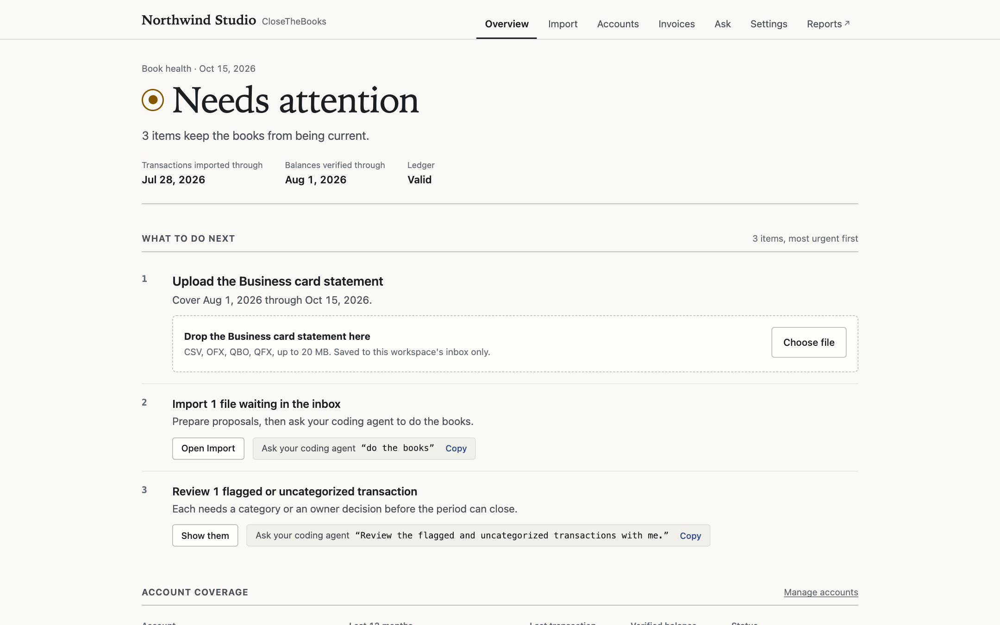
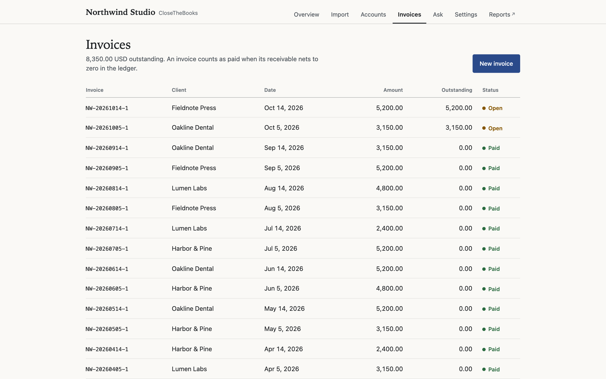

<div align="center">

# CloseTheBooks

**Bookkeeping in plain text, with every balance checked against its statement.**

[](https://github.com/ProofOfReach/closethebooks/actions/workflows/ci.yml)
[](LICENSE)
[](pyproject.toml)

Drop in your statements, ask your coding agent to "do the books", and approve one diff.



</div>

---

## Why CloseTheBooks

- **Verified, not assumed.** A balance counts as verified only when a statement backs it. Each retained statement is SHA-addressed and linked from the ledger.
- **Plain text you own.** The books are a [Beancount](https://beancount.github.io/) ledger in a folder, tracked in git. No database, no vendor lock-in.
- **Nothing posts without review.** The app never writes transactions. Your agent proposes changes, you approve the diff, and git keeps the audit trail.
- **Deterministic where it counts.** Parsing, deduplication, and checks are plain code, not model output. `books check` validates the whole ledger.
- **Runs on your machine.** The web app listens only on `127.0.0.1` and rejects requests without a per-session token.

## Quick start

Requires Python 3.11+. Poppler (`pdftotext`) is optional and improves PDF parsing.

```bash
pipx install .                             # from a checkout; not yet on PyPI
books demo ~/books-demo                    # a fictional company to explore
books --workspace ~/books-demo serve       # open http://127.0.0.1:5170
```

## Start your own books

```bash
books init ~/acme-books --name "Acme Studio LLC" --currency USD --start-date 2026-01-01
cd ~/acme-books
books add-account operating-checking --account Assets:Bank:Operating-Checking
books add-account business-card --account Liabilities:Cards:Business-Card
books serve
```

`books init` creates the workspace:

```
acme-books/
  books.toml        company, currency, account roles, invoice settings
  sources.toml      bank and card accounts: formats, cadence, lifecycle
  ledger/           main.beancount, accounts, years/, documents/, evidence/
  inbox/            statement uploads (gitignored)
  AGENTS.md, CLAUDE.md, .claude/skills/    bookkeeping agent instructions
```

Every company-specific fact lives in `books.toml`. Commands find the workspace from `--workspace`, then `$BOOKS_WORKSPACE`, then the nearest parent folder with a `books.toml`.

## The monthly cycle

1. **Overview** shows book health and the next action, such as "Upload the business card statement covering Aug 1 through Oct 15".
2. **Upload** a statement: CSV, OFX/QFX/QBO, or MT940. PDFs work only with an institution parser preset. **Import** prepares proposals, deduplicated against the ledger, with categories learned from your reviewed history.
3. Ask your coding agent **"do the books"**. It categorizes, posts to the ledger, runs `books check`, and shows you the diff. Approve it to commit.



## What's in the app

| Page | What it does |
| --- | --- |
| Overview | Book health, next actions, a 12-month coverage strip per account, and a financial snapshot |
| Import | Upload statements, prepare proposals, and review suggested categories |
| Accounts | Add or edit bank and card accounts, formats, statement cadence, and lifecycle |
| Invoices | Invoice status read from the ledger. Creates the invoice document and its receivable entry |
| Ask | Read-only questions about the books, answered from the ledger by your locally signed-in Claude or Codex CLI |
| Settings | Company details, invoice defaults, and the one-time move from Xero |
| Reports | [Fava](https://beancount.github.io/fava/): statements, journal, documents, and queries |

The app writes only to the inbox, proposals, statement evidence, invoice documents, account registrations, and settings.

## Statement formats

| Format | Extensions | Notes |
| --- | --- | --- |
| OFX family | `.ofx`, `.qfx`, `.qbo` | Preferred when a bank offers it: stable transaction IDs and a ledger balance |
| CSV | `.csv` | Columns matched by alias. Includes a PayPal preset |
| MT940 | `.mt940`, `.sta`, `.swift` | SWIFT statements, common outside the US |
| PDF | `.pdf` | Only with an institution parser preset (`quickbooks-checking` today) |

See [docs/STATEMENT_FORMATS.md](docs/STATEMENT_FORMATS.md) for the PDF safety model and how to add a preset.

## CLI

```bash
books init DIR --name NAME      # create a workspace
books demo [DIR]                # create a fictional demo workspace
books serve                     # local web app
books status [--json]           # coverage, verification, close obligations
books check                     # validate the ledger (also the git pre-commit hook)
books query "SELECT ..."        # Beancount query language
books add-account KEY --account ACCOUNT [--formats csv,ofx] [--preset P]
books propose --statement KEY=PATH[:preset] [...]
books fetch                     # pull connected Plaid or Teller feeds
books plaid-connect | plaid-accounts | plaid-revisions
books invoice --client NAME --item TEXT --amount N [...]
books report [--year YYYY]      # income, balance, cash flow, trial balance
books agent-files [--force]     # install or refresh the bookkeeping agent instructions
```

## Moving from Xero

Start from a new workspace and open **Settings → Move from Xero**. The page walks through six steps:

1. Create a free Xero app (Mobile or desktop, so no client secret) with the redirect URI the page shows.
2. Sign in and choose the organisation. Access is read-only.
3. Back up the organisation through the API: contacts, invoices, bank transactions, chart of accounts, and attachments. The backup resumes when Xero's daily API limit pauses it.
4. Upload Xero's General Ledger Detail export (.xlsx). The API does not expose the full general ledger.
5. Convert and verify. Every account total is compared with Xero to the cent, and attachments are filed beside their transactions.
6. Register bank and card accounts. Imports begin the day after the Xero history ends.

Conversion is refused once the ledger has its own transactions or registered accounts, so it cannot overwrite real bookkeeping. The same steps exist on the command line: `xero-backup`, `books xero-merge-gl`, `books xero-convert`, `books xero-verify`.

## Status

| Area | Status |
| --- | --- |
| Statement import, ledger, checks, invoices, reports | Stable for this release |
| Xero migration | Included; verified against Xero totals |
| Plaid bank feeds | **Experimental.** Start with sandbox; see [docs/PLAID.md](docs/PLAID.md) |
| Teller bank feeds | Supported; see [docs/teller_connect.html](docs/teller_connect.html) |
| Ask (AI questions) | Runs your locally signed-in `claude` or `codex` CLI. Your question goes to that provider, not to this project |

Version 0.3.0. See [CHANGELOG.md](CHANGELOG.md).

## Development

```bash
python3 -m venv .venv && .venv/bin/pip install -e ".[dev,xero]"
.venv/bin/pytest -q             # 102 tests
```

`PRODUCT.md` defines the product and `DESIGN.md` the interface system. `docs/` covers statement formats, Plaid setup, and Teller.

## License

Apache License 2.0. See [LICENSE](LICENSE).
